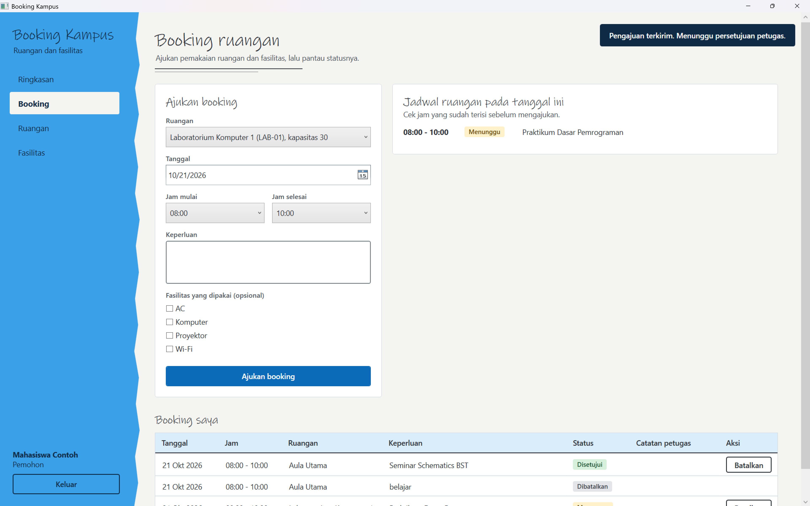
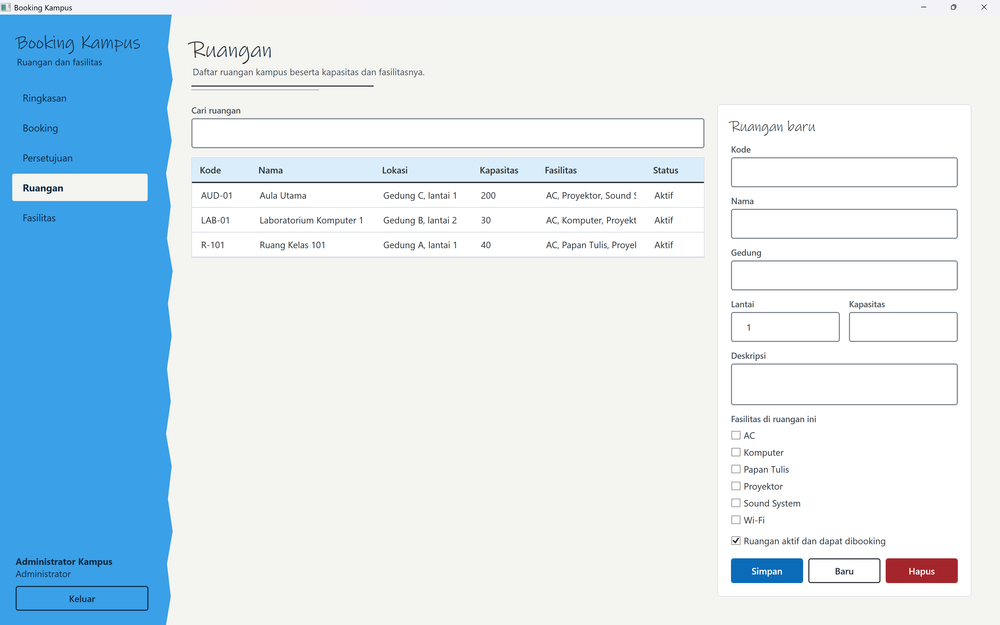

# ETS — Pemrograman Berbasis Kerangka Kerja (PBKK)

| Detail | Keterangan |
| --- | --- |
| **Nama Lengkap** | Nathanael Oliver Amadhika Yuswana |
| **NRP** | 5025241109 |
| **Mata Kuliah** | Pemrograman Berbasis Kerangka Kerja |
| **Kelas** | D |

---
# Kelompok 5

| Anggota Kelompok | NRP |
| --- | --- |
| Willy Marcelius | 5025241096 |
| Nathanael Oliver | 5025241109 |
| Rennard Filbert Tanjaya | 5025241122 |

---

# Link Video Demo

```bash
https://youtu.be/jzrz0WBJIos
```

# Deskripsi

`Sistem Informasi Booking Ruangan dan Fasilitas Kampus`

Aplikasi desktop untuk **mengajukan pemakaian ruangan dan fasilitas kampus**, memeriksa jadwal, serta memproses persetujuan oleh administrator. Dibangun menggunakan **C#**, **XAML**, **.NET 8 (Windows Desktop)**, dan **WPF**. Aplikasi terhubung ke **SQL Server** menggunakan **ADO.NET** (`Microsoft.Data.SqlClient`) dan menerapkan arsitektur **MVVM (Model-View-ViewModel)** dengan lapisan **Service** dan **Repository**.

Dokumen kebutuhan lengkap ada di `PRD_Booking_Kampus.pdf`.

---

## Latar Belakang

Permintaan ruangan lewat komunikasi manual sulit dilacak dan berisiko terlewat, pemohon tidak tahu jadwal yang sudah terisi, dan beberapa pemohon bisa meminta ruangan serta waktu yang sama. Booking Kampus memusatkan alur pengajuan dan persetujuan, menampilkan ketersediaan ruangan, dan menjaga agar jadwal aktif tidak saling bertabrakan.

---

## Peran Pengguna

| Peran | Hak Akses |
| --- | --- |
| **Mahasiswa (Pemohon)** | Melihat ruangan dan fasilitas, melihat jadwal, membuat booking, serta melihat dan membatalkan booking miliknya. Tidak dapat mengelola data master atau memproses persetujuan. |
| **Administrator** | Melihat ringkasan, mengelola ruangan dan fasilitas, mengakses seluruh antrean, serta menyetujui atau menolak pengajuan. Dapat juga membuat booking. |
| **Belum login** | Hanya dapat mengakses halaman login. |

---

## Fitur Utama

- **Autentikasi & Hak Akses Berbasis Peran**
  Login/logout dengan username dan kata sandi (hash menggunakan `BCrypt.Net-Next`). Akun nonaktif ditolak. Pembatasan akses diperiksa di lapisan **Service/Repository**, bukan hanya di tampilan.

- **Dashboard Ringkasan**
  Kartu statistik berisi jumlah booking menunggu, ruangan aktif, fasilitas aktif, dan booking disetujui bulan ini (dihitung dari database), serta daftar booking disetujui untuk hari ini.

- **Katalog & Pengelolaan Ruangan**
  Pencarian berdasarkan kode, nama, atau gedung. Administrator dapat menambah, mengubah, mengaktifkan/menonaktifkan, dan menghapus ruangan (sesuai batasan relasi data), serta menghubungkan fasilitas dengan ruangan.

- **Katalog & Pengelolaan Fasilitas**
  Pencarian dan CRUD fasilitas (nama, deskripsi, status aktif) oleh administrator.

- **Pengajuan Booking**
  Form pengajuan dengan ruangan, tanggal, jam mulai, jam selesai, keperluan, dan fasilitas opsional. Status awal booking adalah **Menunggu**.

- **Jadwal Ruangan**
  Setelah ruangan dan tanggal dipilih, ditampilkan booking berstatus Menunggu dan Disetujui beserta jam dan statusnya.

- **Pencegahan Bentrok Jadwal**
  Pengajuan ditolak jika waktunya bertumpang tindih dengan booking Menunggu/Disetujui pada ruangan dan tanggal yang sama. Waktu yang tepat berdampingan (mis. 08.00–10.00 dan 10.00–11.00) diperbolehkan.

- **Booking Saya & Pembatalan**
  Pemohon melihat daftar booking miliknya beserta status dan catatan administrator, dan dapat membatalkan booking berstatus Menunggu/Disetujui (dengan konfirmasi). Booking yang dibatalkan melepaskan slot.

- **Antrean Persetujuan (Admin)**
  Administrator melihat seluruh booking Menunggu beserta rincian pemohon, waktu, keperluan, dan fasilitas, lalu menyetujui atau menolak. Persetujuan dicek ulang terhadap bentrok dengan booking yang sudah disetujui, dan penolakan wajib menyertakan alasan minimal 3 karakter.

- **Validasi & Penanganan Error**
  Tanggal tidak boleh lampau, jam selesai harus setelah jam mulai, waktu berada di antara 07.00–21.00, dan keperluan 5–200 karakter. Kegagalan koneksi/validasi ditampilkan sebagai pesan yang jelas tanpa membuat aplikasi crash, disertai state loading dan empty state.

---

## Aturan Validasi

| Data | Aturan |
| --- | --- |
| Tanggal booking | Tidak boleh sebelum hari ini |
| Jam booking | 07.00–21.00, jam selesai setelah jam mulai |
| Keperluan | 5–200 karakter (setelah di-trim) |
| Alasan penolakan | Minimal 3 karakter |
| Kapasitas ruangan | Bilangan positif |
| Lantai | 0–50 |
| Kode ruangan / nama fasilitas / username | Unik |

---

## Struktur Database (T-SQL)

Rancangan berikut berdasarkan entitas pada PRD (bagian 11). Tipe data, constraint, dan aturan penghapusan adalah penetapan tim dan dapat disesuaikan dengan `Database/schema.sql`.

```sql
CREATE TABLE Users (
    UserId INT IDENTITY(1,1) CONSTRAINT PK_Users PRIMARY KEY,
    Username VARCHAR(50) NOT NULL CONSTRAINT UQ_Users_Username UNIQUE,
    PasswordHash VARCHAR(100) NOT NULL,
    Nama VARCHAR(100) NOT NULL,
    Email VARCHAR(100) NULL,
    Role VARCHAR(20) NOT NULL CONSTRAINT CK_Users_Role CHECK (Role IN ('Admin', 'Pemohon')),
    IsActive BIT NOT NULL CONSTRAINT DF_Users_IsActive DEFAULT 1
);

CREATE TABLE Ruangan (
    RuanganId INT IDENTITY(1,1) CONSTRAINT PK_Ruangan PRIMARY KEY,
    Kode VARCHAR(20) NOT NULL CONSTRAINT UQ_Ruangan_Kode UNIQUE,
    Nama VARCHAR(100) NOT NULL,
    Gedung VARCHAR(100) NOT NULL,
    Lantai INT NOT NULL CONSTRAINT CK_Ruangan_Lantai CHECK (Lantai BETWEEN 0 AND 50),
    Kapasitas INT NOT NULL CONSTRAINT CK_Ruangan_Kapasitas CHECK (Kapasitas > 0),
    Deskripsi VARCHAR(250) NULL,
    IsActive BIT NOT NULL CONSTRAINT DF_Ruangan_IsActive DEFAULT 1
);

CREATE TABLE Fasilitas (
    FasilitasId INT IDENTITY(1,1) CONSTRAINT PK_Fasilitas PRIMARY KEY,
    Nama VARCHAR(100) NOT NULL CONSTRAINT UQ_Fasilitas_Nama UNIQUE,
    Deskripsi VARCHAR(250) NULL,
    IsActive BIT NOT NULL CONSTRAINT DF_Fasilitas_IsActive DEFAULT 1
);

-- Relasi many-to-many Ruangan <-> Fasilitas
CREATE TABLE RuanganFasilitas (
    RuanganId INT NOT NULL,
    FasilitasId INT NOT NULL,
    CONSTRAINT PK_RuanganFasilitas PRIMARY KEY (RuanganId, FasilitasId),
    CONSTRAINT FK_RuanganFasilitas_Ruangan FOREIGN KEY (RuanganId) REFERENCES Ruangan(RuanganId),
    CONSTRAINT FK_RuanganFasilitas_Fasilitas FOREIGN KEY (FasilitasId) REFERENCES Fasilitas(FasilitasId)
);

CREATE TABLE Booking (
    BookingId INT IDENTITY(1,1) CONSTRAINT PK_Booking PRIMARY KEY,
    UserId INT NOT NULL,
    RuanganId INT NOT NULL,
    Tanggal DATE NOT NULL,
    JamMulai TIME NOT NULL,
    JamSelesai TIME NOT NULL,
    Keperluan VARCHAR(200) NOT NULL,
    Status VARCHAR(20) NOT NULL
        CONSTRAINT DF_Booking_Status DEFAULT 'Menunggu'
        CONSTRAINT CK_Booking_Status CHECK (Status IN ('Menunggu', 'Disetujui', 'Ditolak', 'Dibatalkan')),
    CatatanApprover VARCHAR(250) NULL,
    CreatedAt DATETIME2 NOT NULL CONSTRAINT DF_Booking_CreatedAt DEFAULT SYSDATETIME(),
    CONSTRAINT CK_Booking_Jam CHECK (JamSelesai > JamMulai),
    CONSTRAINT FK_Booking_Users FOREIGN KEY (UserId) REFERENCES Users(UserId),
    CONSTRAINT FK_Booking_Ruangan FOREIGN KEY (RuanganId) REFERENCES Ruangan(RuanganId)
);

-- Fasilitas yang diminta pada sebuah booking
CREATE TABLE BookingFasilitas (
    BookingId INT NOT NULL,
    FasilitasId INT NOT NULL,
    CONSTRAINT PK_BookingFasilitas PRIMARY KEY (BookingId, FasilitasId),
    CONSTRAINT FK_BookingFasilitas_Booking FOREIGN KEY (BookingId) REFERENCES Booking(BookingId) ON DELETE CASCADE,
    CONSTRAINT FK_BookingFasilitas_Fasilitas FOREIGN KEY (FasilitasId) REFERENCES Fasilitas(FasilitasId)
);
```

### Relasi Utama

```plaintext
Users   1 ───── * Booking
Ruangan 1 ───── * Booking
Ruangan 1 ───── * RuanganFasilitas * ───── 1 Fasilitas
Booking 1 ───── * BookingFasilitas * ───── 1 Fasilitas
```

---


## Arsitektur Singkat

Tampilan WPF/XAML dipisahkan dari state dan command di ViewModel. Service menangani autentikasi serta aturan bisnis, sementara Repository menjalankan query SQL berparameter. Skema database dan data awal berada di `Database/schema.sql`; aplikasi menjalankannya saat startup.

## Arsitektur

| Lapisan | Tanggung Jawab | Contoh |
| --- | --- | --- |
| **View** | Tampilan dan interaksi WPF/XAML | `LoginWindow`, `BookingView`, `ApprovalView`, `RuanganView` |
| **ViewModel** | State UI, command, validasi tampilan, orkestrasi operasi | `BookingViewModel`, `ApprovalViewModel` |
| **Model** | Entitas dan status domain | `Booking`, `Ruangan`, `Fasilitas`, `User` |
| **Service** | Aturan bisnis, autentikasi, validasi, otorisasi | `BookingService`, `AuthService` |
| **Repository** | Query berparameter, transaksi, pemetaan data SQL | `BookingRepository`, `RuanganRepository` |
| **Database** | Penyimpanan relasional dan constraint | SQL Server (`Database/schema.sql`) |

## Teknologi

- C# dan WPF dengan .NET 8 untuk Windows
- XAML dan pola MVVM (`CommunityToolkit.Mvvm`)
- SQL Server melalui ADO.NET (`Microsoft.Data.SqlClient`)
- BCrypt untuk hashing kata sandi (`BCrypt.Net-Next`)

---

## Struktur Project

> Sesuaikan nama file dengan struktur project yang sebenarnya.

```plaintext
BookingKampus/
│
├── Database/
│   └── schema.sql             # Skema SQL Server + data awal (seed) untuk demo
├── Models/
│   ├── User.cs
│   ├── Ruangan.cs
│   ├── Fasilitas.cs
│   └── Booking.cs
├── Repositories/
│   ├── UserRepository.cs
│   ├── RuanganRepository.cs
│   ├── FasilitasRepository.cs
│   └── BookingRepository.cs   # Query berparameter ke SQL Server via ADO.NET
├── Services/
│   ├── AuthService.cs         # Login, hash BCrypt, sesi pengguna
│   └── BookingService.cs      # Validasi, deteksi bentrok, otorisasi, approval
├── ViewModels/
│   ├── LoginViewModel.cs
│   ├── DashboardViewModel.cs
│   ├── BookingViewModel.cs
│   ├── ApprovalViewModel.cs
│   ├── RuanganViewModel.cs
│   └── FasilitasViewModel.cs
├── Views/
│   ├── LoginWindow.xaml
│   ├── MainWindow.xaml        # Shell + sidebar navigasi
│   ├── DashboardView.xaml
│   ├── BookingView.xaml
│   ├── ApprovalView.xaml      # Hanya tampil untuk Administrator
│   ├── RuanganView.xaml
│   └── FasilitasView.xaml
├── Themes/                    # Resource bersama: warna, tipografi, tombol, kartu, badge
├── appsettings.json           # Connection string (per lingkungan, tidak berisi kredensial produksi)
├── App.xaml
└── App.xaml.cs
```

---

## Cara Build dan Menjalankan Project

**Prasyarat:** Windows, .NET 8 SDK, SQL Server (atau SQL Server Express/LocalDB), dan SQL Server Management Studio (SSMS).

1. **Setup Database SQL Server:**
   Jalankan `Database/schema.sql` pada **SSMS** untuk membuat database beserta tabel dan data awal demo.

2. **Atur Connection String:**
   Ubah connection string pada `appsettings.json` sesuai instance SQL Server Anda. Jangan menyimpan kredensial produksi di repositori.

3. **Masuk ke folder project:**
   ```bash
   cd BookingKampus
   ```

4. **Restore Package:**
   ```bash
   dotnet add package Microsoft.Data.SqlClient
   dotnet add package CommunityToolkit.Mvvm
   dotnet add package BCrypt.Net-Next
   ```

5. **Jalankan Aplikasi:**
   ```bash
   dotnet run
   ```

### Akun Demo

| Peran | Username | Kata Sandi |
| --- | --- | --- |
| Administrator | admin | Admin123! |
| Mahasiswa | mahasiswa | Mahasiswa123! |

---

## Alur Pengguna Utama

**Pengajuan Booking**
1. Pengguna login, membuka menu **Booking**, lalu memilih ruangan aktif dan tanggal.
2. Sistem menampilkan jadwal aktif ruangan pada tanggal tersebut.
3. Pengguna memilih jam mulai, jam selesai, fasilitas opsional, dan mengisi keperluan.
4. Sistem memvalidasi input dan memastikan tidak ada booking aktif yang bertumpang tindih.
5. Jika valid, booking disimpan dengan status **Menunggu** dan muncul di "Booking Saya" serta jadwal ruangan.

**Persetujuan / Penolakan (Administrator)**
1. Administrator membuka menu **Persetujuan** dan memilih pengajuan.
2. Administrator memeriksa pemohon, jadwal, keperluan, dan fasilitas.
3. Administrator menyetujui, atau mengisi alasan lalu menolak.
4. Sistem memeriksa status terbaru dan bentrok dengan booking yang sudah disetujui, lalu menyimpan status dan catatan.

**Pembatalan**
1. Pemilik booking memilih **Batalkan** pada booking berstatus Menunggu/Disetujui.
2. Setelah konfirmasi, status menjadi **Dibatalkan** dan slot tersedia kembali.

---

## Skenario Pengujian

> Isi kolom **Status** setelah pengujian dilakukan.

| Area | Kasus Uji | Expected Output | Status |
|---|---|---|---|
| **Login** | Kredensial benar, salah, dan akun nonaktif | Akses diberikan atau ditolak dengan pesan yang tepat | |
| **Hak Akses** | Mahasiswa mencoba aksi admin | Operasi ditolak di lapisan Service/Data | |
| **Data Master** | Data valid, kolom wajib kosong, nilai batas, kode/nama duplikat | Data valid tersimpan, nilai tidak valid ditolak | |
| **Pengajuan** | Tanggal lampau, jam di luar 07.00–21.00, selesai sebelum mulai, keperluan terlalu pendek/panjang | Pengajuan tidak valid ditolak | |
| **Bentrok** | Interval beririsan, slot berdampingan, ruangan/tanggal lain | Bentrok ditolak; slot berdampingan dan sumber daya lain dapat digunakan | |
| **Status** | Setuju, tolak tanpa alasan, tolak dengan alasan, proses booking yang sudah diproses | Transisi status sesuai aturan; alasan wajib untuk penolakan | |
| **Pembatalan** | Batalkan booking sendiri dan booking orang lain | Pemilik dapat membatalkan, pengguna lain ditolak | |
| **Dashboard** | Data tersedia dan database kosong | Statistik sesuai query dan empty state jelas | |
| **Jadwal** | Booking pada ruangan dan tanggal berbeda | Hanya booking yang relevan ditampilkan | |

---

## Tampilan Aplikasi

| Login | Dashboard |
| --- | --- |
|  |  |

| Katalog ruangan | Form booking |
| --- | --- |
|  |  |

| Booking berhasil | Antrean persetujuan |
| --- | --- |
|  |  |

| Pengelolaan ruangan | Pengelolaan fasilitas |
| --- | --- |
|  |  |

Contoh validasi juga tersedia di folder [`Documentation`](Documentation/).

---

## Jawaban Pertanyaan

### 1. Deskripsi dan Ruang Lingkup Fitur Aplikasi Desktop Rich UI

**Deskripsi Aplikasi:**
*Booking Kampus* adalah aplikasi *desktop* modern berteknologi Rich UI (menggunakan WPF, C#, XAML, .NET 8, serta SQL Server dengan ADO.NET) yang dirancang untuk memfasilitasi civitas akademika dalam mengajukan pemakaian ruangan dan fasilitas kampus, memeriksa ketersediaan jadwal, serta memproses persetujuan secara terpusat.

**Ruang Lingkup Fitur (In-Scope Rilis Awal):**

* **Autentikasi & Manajemen Sesi:** Fitur login dan logout berbasis *username* dan kata sandi dengan validasi akun aktif serta pembatasan hak akses berbasis peran (*role-based access control*) untuk Mahasiswa, Administrator, dan Pengguna Belum Login.


* **Dashboard & Ringkasan Operasional:** Menyediakan statistik jumlah booking *Menunggu*, ruangan aktif, fasilitas aktif, booking yang disetujui bulan ini, serta daftar booking yang disetujui untuk hari ini.


* **Katalog & Pengelolaan Ruangan & Fasilitas:**
* Pencarian dan penayangan detail ruangan (kode, nama, gedung, lantai, kapasitas, deskripsi, fasilitas terkait, dan status aktif).


* Pengelolaan data master (tambah, ubah, aktif/non-aktif, dan hapus) oleh Administrator.


* **Pengajuan & Validasi Booking:**
* Formulir pengajuan pemakaian ruangan yang mencakup pemilihan tanggal, jam mulai, jam selesai (antara pukul 07.00–21.00), keperluan (5–200 karakter), serta fasilitas opsional.


* Validasi otomatis sistem (memastikan ruangan aktif, tanggal tidak lampau, durasi valid) serta pencegahan bentrok waktu secara ketat (menolak pengajuan jika bertumpang tindih dengan status *Menunggu* atau *Disetujui* pada ruangan dan tanggal yang sama).


* **Manajemen Booking Pengguna ("Booking Saya"):** Pemohon dapat memantau status pengajuannya (Menunggu, Disetujui, Ditolak, Dibatalkan), melihat catatan dari administrator, serta membatalkan booking yang masih aktif agar slot kembali terbuka.


* **Antrean & Proses Persetujuan (Administrator):** Halaman khusus bagi admin untuk meninjau rincian pemohon, menyetujui, atau menolak pengajuan (penolakan wajib menyertakan alasan minimal 3 karakter).


---

### 2. Latar Belakang dan Manfaat Pembuatan Aplikasi

**Latar Belakang:**

* **Komunikasi Manual yang Kurang Efektif:** Permintaan peminjaman ruangan yang sebelumnya dilakukan secara manual atau melalui komunikasi tidak terpusat sangat sulit dilacak dan berisiko tinggi terlewat.


* **Kurangnya Informasi Jadwal:** Pemohon sering kali kesulitan mengetahui ketersediaan waktu secara akurat sebelum memutuskan memilih jadwal ruangan.


* **Risiko Bentrok Jadwal (Double Booking):** Kerap terjadi kasus di mana beberapa pihak meminta ruangan dan waktu pemakaian yang sama secara bersamaan tanpa adanya sistem pencegah otomatis.


* **Ketiadaan Antrean Terstruktur:** Administrator membutuhkan wadah antrean pengajuan yang rapi beserta rincian kebutuhan fasilitas yang transparan.


* **Konsistensi Data Master:** Kebutuhan untuk mengelola data kapasitas, lokasi, status, serta ketersediaan fasilitas ruangan secara konsisten dalam basis data.


**Manfaat Aplikasi:**

* **Bagi Mahasiswa/Pemohon:**
* Mempermudah proses pengajuan penggunaan ruangan dan fasilitas kampus secara digital dan terstruktur.


* Menyediakan transparansi informasi jadwal ruangan secara *real-time* agar pemohon dapat memilih slot waktu yang benar-benar kosong.


* Memudahkan pemantauan status pengajuan serta pengelolaan pembatalan mandiri.


* **Bagi Administrator:**
* Mencegah terjadinya bentrok (*double booking*) pemakaian ruangan secara otomatis melalui sistem validasi waktu.


* Menyediakan antrean persetujuan yang terpusat dan terorganisir untuk memproses atau menolak pengajuan secara akurat (disertai catatan alasan).


* Mengelola katalog data master ruangan, fasilitas, dan relasinya dengan lebih konsisten dan aman.

### 3. Infografis Aplikasi

!(Documentation/infografis.png)


