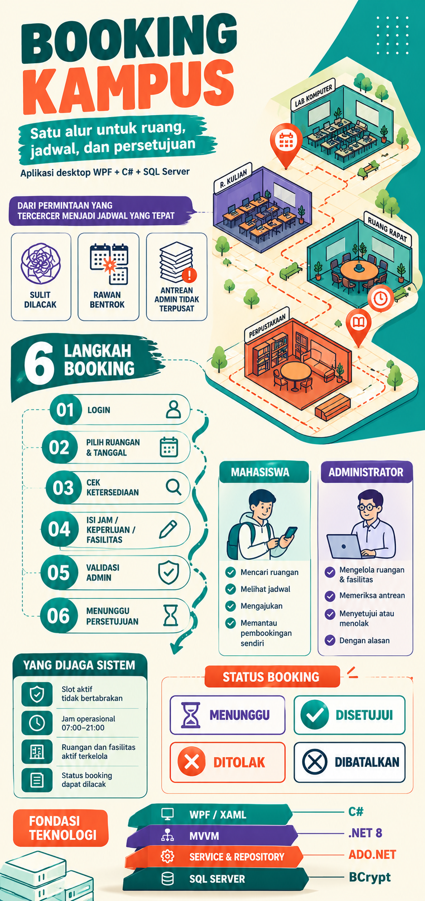

### 1. Deskripsi dan Ruang Lingkup Fitur Aplikasi Desktop Rich UI

**Deskripsi Aplikasi:**
*Booking Kampus* adalah aplikasi *desktop* modern berteknologi Rich UI (menggunakan WPF, C#, XAML, .NET 8, serta SQL Server dengan ADO.NET) yang dirancang untuk memfasilitasi civitas akademika dalam mengajukan pemakaian ruangan dan fasilitas kampus, memeriksa ketersediaan jadwal, serta memproses persetujuan secara terpusat.

**Ruang Lingkup Fitur (In-Scope Rilis Awal):**

* **Autentikasi & Manajemen Sesi:** Fitur login dan logout berbasis *username* dan kata sandi dengan validasi akun aktif serta pembatasan hak akses berbasis peran (*role-based access control*) untuk Mahasiswa, Administrator, dan Pengguna Belum Login.

* **Dashboard & Ringkasan Operasional:** Menyediakan statistik jumlah booking *Menunggu*, ruangan aktif, fasilitas aktif, booking yang disetujui bulan ini, serta daftar booking yang disetujui untuk hari ini.

* **Katalog & Pengelolaan Ruangan & Fasilitas:**
* Pencarian dan penayangan detail ruangan (kode, nama, gedung, lantai, kapasitas, deskripsi, fasilitas terkait, dan status aktif).

* Pengelolaan data master (tambah, ubah, aktif/non-aktif, dan hapus) oleh Administrator.

* **Pengajuan & Validasi Booking:**
* Formulir pengajuan pemakaian ruangan yang mencakup pemilihan tanggal, jam mulai, jam selesai (antara pukul 07.00–21.00), keperluan (5–200 karakter), serta fasilitas opsional.

* Validasi otomatis sistem (memastikan ruangan aktif, tanggal tidak lampau, durasi valid) serta pencegahan bentrok waktu secara ketat (menolak pengajuan jika bertumpang tindih dengan status *Menunggu* atau *Disetujui* pada ruangan dan tanggal yang sama).

* **Manajemen Booking Pengguna ("Booking Saya"):** Pemohon dapat memantau status pengajuannya (Menunggu, Disetujui, Ditolak, Dibatalkan), melihat catatan dari administrator, serta membatalkan booking yang masih aktif agar slot kembali terbuka.

* **Antrean & Proses Persetujuan (Administrator):** Halaman khusus bagi admin untuk meninjau rincian pemohon, menyetujui, atau menolak pengajuan (penolakan wajib menyertakan alasan minimal 3 karakter).

---

### 2. Latar Belakang dan Manfaat Pembuatan Aplikasi

**Latar Belakang:**

* **Komunikasi Manual yang Kurang Efektif:** Permintaan peminjaman ruangan yang sebelumnya dilakukan secara manual atau melalui komunikasi tidak terpusat sangat sulit dilacak dan berisiko tinggi terlewat.

* **Kurangnya Informasi Jadwal:** Pemohon sering kali kesulitan mengetahui ketersediaan waktu secara akurat sebelum memutuskan memilih jadwal ruangan.

* **Risiko Bentrok Jadwal (Double Booking):** Kerap terjadi kasus di mana beberapa pihak meminta ruangan dan waktu pemakaian yang sama secara bersamaan tanpa adanya sistem pencegah otomatis.

* **Ketiadaan Antrean Terstruktur:** Administrator membutuhkan wadah antrean pengajuan yang rapi beserta rincian kebutuhan fasilitas yang transparan.

* **Konsistensi Data Master:** Kebutuhan untuk mengelola data kapasitas, lokasi, status, serta ketersediaan fasilitas ruangan secara konsisten dalam basis data.

**Manfaat Aplikasi:**

* **Bagi Mahasiswa/Pemohon:**
* Mempermudah proses pengajuan penggunaan ruangan dan fasilitas kampus secara digital dan terstruktur.

* Menyediakan transparansi informasi jadwal ruangan secara *real-time* agar pemohon dapat memilih slot waktu yang benar-benar kosong.

* Memudahkan pemantauan status pengajuan serta pengelolaan pembatalan mandiri.

* **Bagi Administrator:**
* Mencegah terjadinya bentrok (*double booking*) pemakaian ruangan secara otomatis melalui sistem validasi waktu.

* Menyediakan antrean persetujuan yang terpusat dan terorganisir untuk memproses atau menolak pengajuan secara akurat (disertai catatan alasan).

* Mengelola katalog data master ruangan, fasilitas, dan relasinya dengan lebih konsisten dan aman.

### 3. Infografis Aplikasi

File infografis dapat diakses pada Folder (Documentation/infografis.png)

