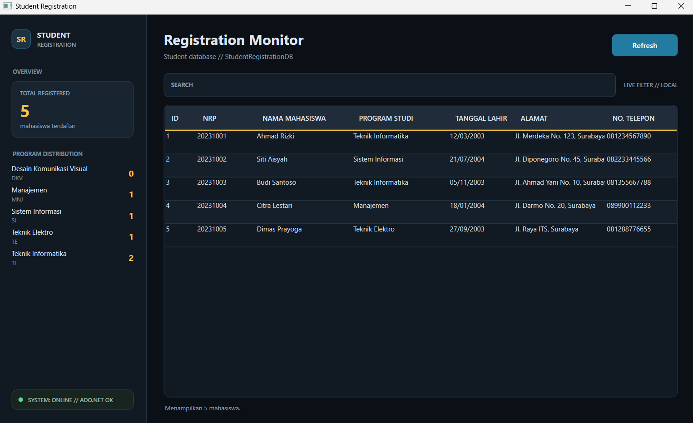
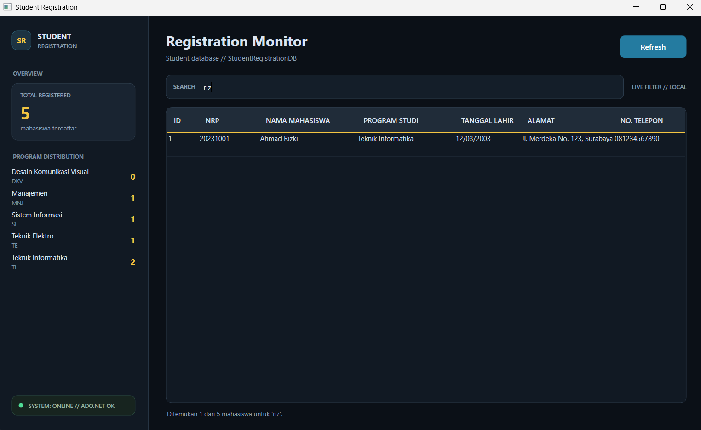
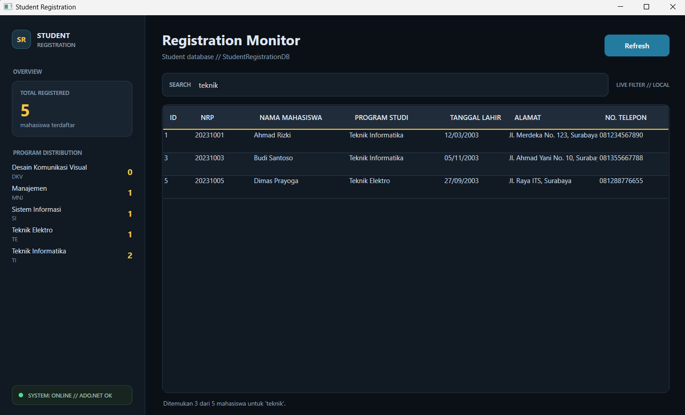
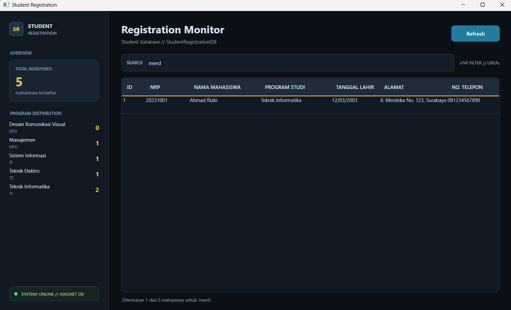
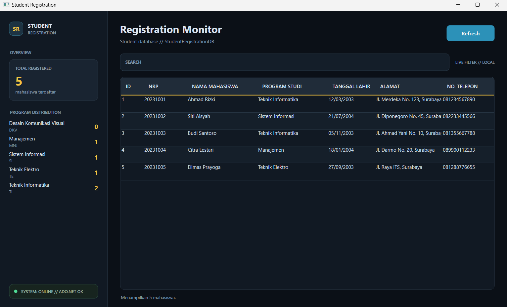

# Pertemuan 6 — Pemrograman Berbasis Kerangka Kerja (PBKK)

| Detail | Keterangan |
| --- | --- |
| **Nama Lengkap** | Nathanael Oliver Amadhika Yuswana |
| **NRP** | 5025241109 |
| **Mata Kuliah** | Pemrograman Berbasis Kerangka Kerja |
| **Kelas** | D |

---

# Student Registration

Student Registration adalah aplikasi desktop untuk memantau data pendaftaran mahasiswa. Aplikasi dibuat dengan C# dan WPF (.NET 8), menggunakan SQL Server sebagai penyimpanan data, ADO.NET untuk akses database, dan Repository Pattern untuk memisahkan proses pengambilan data.

## Fitur

- Menampilkan data mahasiswa dalam `DataGrid`, termasuk nama program studi yang diperoleh melalui relasi tabel `Students` dan `Programs`.
- Mencari data secara real-time berdasarkan NRP, nama, program studi, atau alamat. Filter berjalan pada data yang telah dimuat di aplikasi, tanpa query server setiap kali pengguna mengetik.
- Menampilkan jumlah seluruh mahasiswa dan jumlah mahasiswa per program studi. Statistik membaca daftar program dari database, sehingga program dengan nol mahasiswa tetap terlihat.
- Memuat ulang data dengan tombol **Refresh** dan mengosongkan kata kunci pencarian.
- Menampilkan status koneksi database dan dialog error jika proses pemuatan gagal.
- Menggunakan dashboard sidebar bertema gelap Cyberpunk Slate dengan aksen biru dan kuning.

## Teknologi dan arsitektur

- C#, .NET 8, dan Windows Presentation Foundation (WPF).
- SQL Server dengan database `StudentRegistrationDB`.
- `Microsoft.Data.SqlClient` sebagai provider SQL Server.
- `StudentRepository` menggunakan `SqlConnection`, `SqlCommand`, dan `SqlDataReader`.
- Relasi one-to-many (1:N): satu program studi di tabel `Programs` dapat dimiliki banyak mahasiswa di tabel `Students`.
- Query `INNER JOIN` mengambil mahasiswa bersama program studinya. Query statistik memakai `LEFT JOIN` agar program tanpa mahasiswa tetap dihitung dengan nilai nol.

## Persyaratan

- Windows 10/11.
- .NET 8 SDK.
- SQL Server Database Engine.
- SSMS atau ekstensi SQL Server di VS Code untuk menyiapkan database.

## Persiapan database

1. Hubungkan SSMS ke instance SQL Server yang akan digunakan.
2. Jika database `StudentRegistrationDB` belum ada, jalankan perintah berikut:

   ```sql
   IF DB_ID(N'StudentRegistrationDB') IS NULL
       CREATE DATABASE StudentRegistrationDB;
   GO
   ```

3. Buka `database/database.sql` dan jalankan seluruh script. Script membuat tabel `Programs` dan `Students` jika belum tersedia, kemudian menambahkan data contoh jika NRP tersebut belum ada.
4. Pastikan query di akhir script menampilkan data mahasiswa dan program studi.

Script `database/database.sql` diawali dengan `USE StudentRegistrationDB`, jadi database harus dibuat terlebih dahulu. Script tidak menghapus database yang sudah ada.

## Konfigurasi koneksi

Buka `DatabaseConfig.cs`, lalu sesuaikan nama server dengan instance SQL Server Anda. Connection string project saat ini:

```csharp
public static readonly string ConnectionString =
    @"Server=LAPTOP-KCF1PSHL;Database=StudentRegistrationDB;Trusted_Connection=True;TrustServerCertificate=True;";
```

`LAPTOP-KCF1PSHL` adalah nama server yang tersimpan di konfigurasi saat ini. Ganti nilai `Server` jika berbeda di komputer Anda. Connection string menggunakan Windows Authentication.

## Build dan jalankan

Buka terminal Windows pada folder `StudentRegistration`—folder yang berisi `StudentRegistration.csproj`—kemudian jalankan:

```powershell
dotnet restore
dotnet build
dotnet run
```

WPF berjalan di Windows. Pastikan SQL Server aktif, database telah disiapkan, dan connection string sesuai.

## Cara menggunakan

1. Jalankan aplikasi. Jika pemuatan berhasil, dashboard menampilkan total mahasiswa, statistik per program studi, dan status `SYSTEM: ONLINE // ADO.NET OK`.
2. Ketik NRP, nama, program studi, atau alamat pada kolom **Search** untuk memfilter tabel. Jumlah hasil ditampilkan di bawah tabel.
3. Klik **Refresh** untuk mengambil data terbaru dari database dan mengosongkan pencarian.
4. Jika koneksi atau query gagal, aplikasi menampilkan status offline dan dialog berisi detail error.

## Dokumentasi screenshot

### Tampilan awal dan dashboard



### Pencarian NRP dan nama




### Pencarian program studi dan alamat





### Refresh data



## Struktur project

```text
StudentRegistration/
├── Models/
│   ├── Program.cs
│   └── Student.cs
├── Repositories/
│   └── StudentRepository.cs
├── database/
│   └── database.sql
├── App.xaml
├── App.xaml.cs
├── DatabaseConfig.cs
├── MainWindow.xaml
├── MainWindow.xaml.cs
└── StudentRegistration.csproj
```

## Tanggung jawab file

- `Models/Program.cs`: model data program studi.
- `Models/Student.cs`: model data mahasiswa dan atribut program studi hasil relasi.
- `Repositories/StudentRepository.cs`: query data mahasiswa, jumlah total, dan statistik program studi.
- `MainWindow.xaml`: tampilan dashboard, kotak pencarian, dan tabel mahasiswa.
- `MainWindow.xaml.cs`: pemuatan data, filter lokal, statistik, dan penanganan error.
- `DatabaseConfig.cs`: konfigurasi koneksi SQL Server.
- `database/database.sql`: pembuatan tabel dan pengisian data contoh.
- `StudentRegistration.csproj`: konfigurasi WPF .NET 8 dan dependensi SqlClient.

## Pemecahan masalah

- Jika muncul dialog **Database Error**, pastikan SQL Server aktif, database `StudentRegistrationDB` tersedia, dan nama server pada `DatabaseConfig.cs` benar.
- Pastikan akun Windows yang menjalankan aplikasi memiliki izin mengakses database.
- Jika build gagal, pastikan .NET 8 SDK terpasang dan perintah dijalankan dari Windows.
